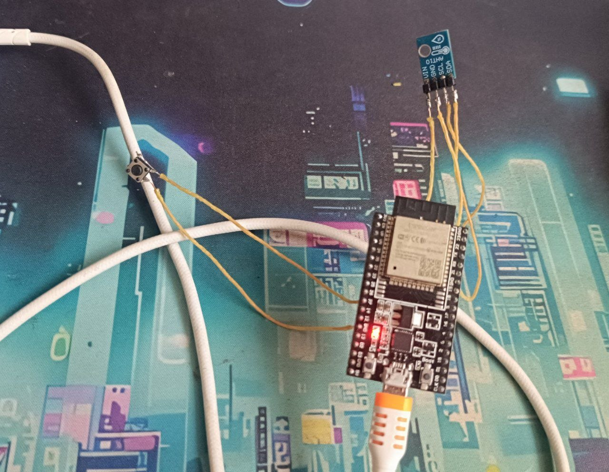
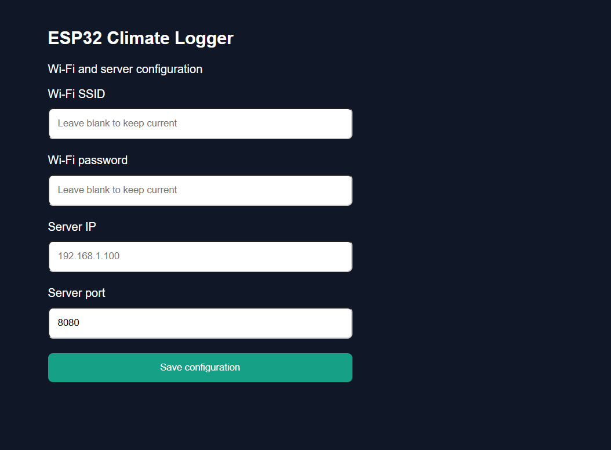
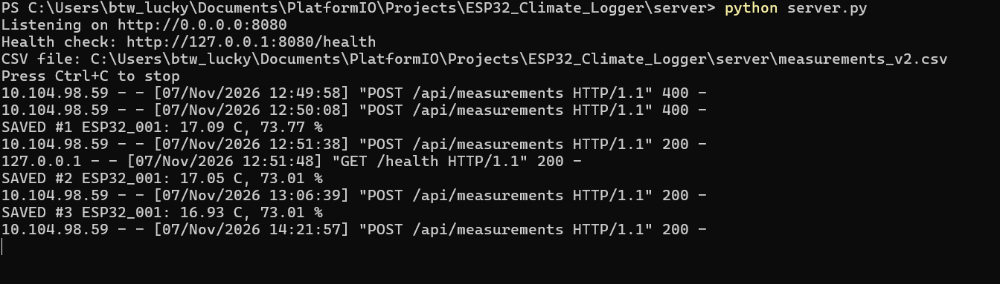
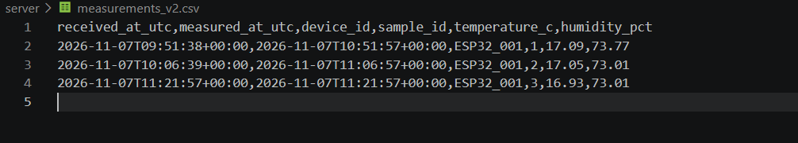

# Quick Start — ESP32 Climate Logger

This guide walks through configuring the ESP32 with its push button, connecting it to your Wi-Fi network, starting the Python test server on Windows, and confirming the first temperature/humidity upload.

## Requirements

- ESP32 with **AHT10** sensor and push button already wired and programmed with this repository's firmware.
- A **2.4 GHz Wi-Fi** network that both the ESP32 and your computer can access. Devices must be able to communicate directly (some phone hotspots isolate clients).
- Windows computer with **Python 3** installed and the project downloaded or cloned.
- USB cable for power and, optionally, VS Code + PlatformIO for the Serial Monitor.

### Wiring reference

| Component pin | ESP32 pin                                         |
| ------------- | ------------------------------------------------- |
| AHT10 VIN     | 3V3                                               |
| AHT10 GND     | GND                                               |
| AHT10 SDA     | GPIO21                                            |
| AHT10 SCL     | GPIO22                                            |
| Push button   | GPIO27 and GND (contacts that close when pressed) |



## 1. Enter configuration mode with the button

1. Power the ESP32 from USB.
2. **Press and hold the external button for at least 3 seconds.**
3. The ESP32 starts its setup Wi-Fi access point: **`ESP32-Climate-Setup`**.
4. Connect a phone or laptop to that Wi-Fi network. The setup password is the value of `AP_PASS` in `src/main.cpp` (the prototype firmware uses `ClimateSet_7284`). **Change this password before deploying the device beyond a trusted test environment.**
5. If your phone says "No internet," stay connected to the ESP32 network.
6. Open **http://192.168.4.1** in the browser.

> On a brand-new device with no saved Wi-Fi credentials, setup mode starts automatically. Holding the button also opens it whenever the ESP32 is running.



## 2. Find the test server's IP address

On the Windows computer that will run the server:

1. Connect the computer to the **same reachable Wi-Fi network** you intend to use for the ESP32.
2. Open **PowerShell** or **Command Prompt**.
3. Run:

   ```powershell
   ipconfig
   ```

4. Find **IPv4 Address** under the active Wi-Fi adapter. For example: `10.104.98.79`. **Your address may be different.**

**Do not use `127.0.0.1` as the ESP32's server address**; that address refers to the ESP32 itself when used on the device. **`192.168.4.1` is only the ESP32 setup page**, not your Python server.

## 3. Save Wi-Fi and server settings

On **http://192.168.4.1**, enter:

| Field                   | What to enter                                                         |
| ----------------------- | --------------------------------------------------------------------- |
| **Wi-Fi SSID**          | Name of your 2.4 GHz Wi-Fi network                                    |
| **Wi-Fi password**      | Password for that network                                             |
| **Server IPv4 address** | The computer's IPv4 address from Step 2 (for example, `10.104.98.79`) |
| **Server port**         | `8080`                                                                |

- If this Wi-Fi network is **already saved**, you can leave both Wi-Fi fields blank to keep the saved credentials.
- If changing to a **different network**, enter **both** the new SSID and its password.
- Select **Save and restart**. The ESP32 stores the settings in non-volatile memory and reboots.
- Wait for the ESP32 to reconnect to the normal Wi-Fi network. The setup access point will disappear after reboot when a Wi-Fi network is configured.

You do **not** have to reflash firmware to change the destination IP later: repeat Steps 1–3.

## 4. Start the Python test server on Windows

Open a **new PowerShell window**, then go to your cloned project folder. For example:

```powershell
cd "$HOME\Documents\PlatformIO\Projects\ESP32_Climate_Logger"
```

Start the server:

```powershell
python .\server\server.py
```

> If `python` is not recognized, install Python from [python.org](https://www.python.org/downloads/windows/) and open a new PowerShell window. Check with `python --version`.

Expected output (example):

```text
Listening on http://0.0.0.0:8080
Health check: http://127.0.0.1:8080/health
CSV file: ...\server\measurements_v2.csv
Press Ctrl+C to stop
```

**Keep the PowerShell window open.** The test server runs while the command is running; press `Ctrl+C` to stop it. If Windows Firewall asks, allow Python on your **trusted private network** only.

## 5. Verify that the server is running

On the **computer running the server**, open:

**http://127.0.0.1:8080/health**

Expected response:

```json
{ "status": "ok" }
```

This checks the Python server on the computer. It does **not** by itself prove that the ESP32 can reach it.

## 6. Wait for the first upload

After ESP32 boot, the firmware normally takes its **first measurement after about 15 seconds**, then takes a new measurement **every 15 minutes** (by default). A queued reading is transmitted when Wi-Fi and the server are available.

For detailed device logs, open PlatformIO **Serial Monitor at 115200 baud**. A successful upload looks like:

```text
[WiFi] CONNECTED. IP: 10.104.98.59
[TIME] UTC clock synchronized
[SENSOR] 17.47 C | 72.80 %
[QUEUE] Added sample #1, pending=1, UTC=..., saved=YES
[HTTP] POST sample #1 -> http://10.104.98.79:8080/api/measurements
[HTTP] SUCCESS 200
[QUEUE] Delivered. Pending=0
```

These are **illustrative values and IP addresses**, not fixed settings.

The Python server should display something like:

```text
SAVED #1 ESP32_001: 17.47 C, 72.80 %
... "POST /api/measurements HTTP/1.1" 200 -
```

The measurements are written to:

```text
server/measurements_v2.csv
```

The file contains `received_at_utc`, `measured_at_utc`, `device_id`, `sample_id`, `temperature_c`, and `humidity_pct`.





## Troubleshooting

| Symptom                           | What to check                                                                                                                                                                |
| --------------------------------- | ---------------------------------------------------------------------------------------------------------------------------------------------------------------------------- |
| `ESP32-Climate-Setup` not visible | Hold the **external GPIO27 button** for 3+ seconds while powered; check Serial Monitor.                                                                                      |
| `192.168.4.1` does not open       | Connect directly to `ESP32-Climate-Setup` first; turn off mobile data temporarily if needed; use `http://` rather than `https://`.                                           |
| ESP32 cannot connect to Wi-Fi     | Re-enter SSID/password; use 2.4 GHz and WPA2-compatible security; inspect `Disconnect reason` in Serial Monitor.                                                             |
| `/health` does not respond        | Check that `python .\server\server.py` is still running and that port `8080` is free.                                                                                        |
| Server healthy but no HTTP upload | Verify the ESP32 **Server IPv4** matches your computer's current `ipconfig` address, both devices can communicate, and firewall/client isolation does not block port `8080`. |
| `[HTTP] Network error`            | Keep the server running; check IP, firewall, network reachability, and Wi-Fi. The sample stays queued for retry.                                                             |
| No new reading immediately        | Normal: first reading after ~15 s, subsequent readings every 15 minutes.                                                                                                     |
| `measured_at_utc` is blank        | ESP32 had not synchronized its clock via NTP; the server intentionally does not invent a measurement time.                                                                   |

### Optional quick test: 10-second measurement interval

To verify the system without waiting 15 minutes, temporarily change this line in `src/main.cpp`:

```cpp
constexpr uint32_t MEASURE_INTERVAL_MS = 900000UL;
```

to:

```cpp
constexpr uint32_t MEASURE_INTERVAL_MS = 10000UL;
```

Rebuild and upload with PlatformIO. Once testing is complete, **restore `900000UL` and upload again**.

## Security notes

- This example server uses **HTTP without authentication**; use it on a **trusted local network only**, not exposed to the public Internet.
- Change the firmware's demo access-point password before deployment.
- Never commit real Wi-Fi credentials, access tokens, or private files. Server-generated CSV files may be excluded from Git; keep a curated sample under `data/` for documentation.
