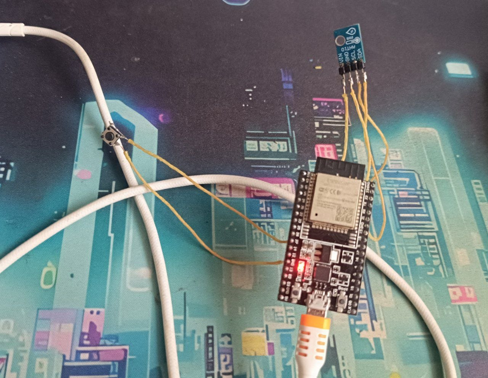
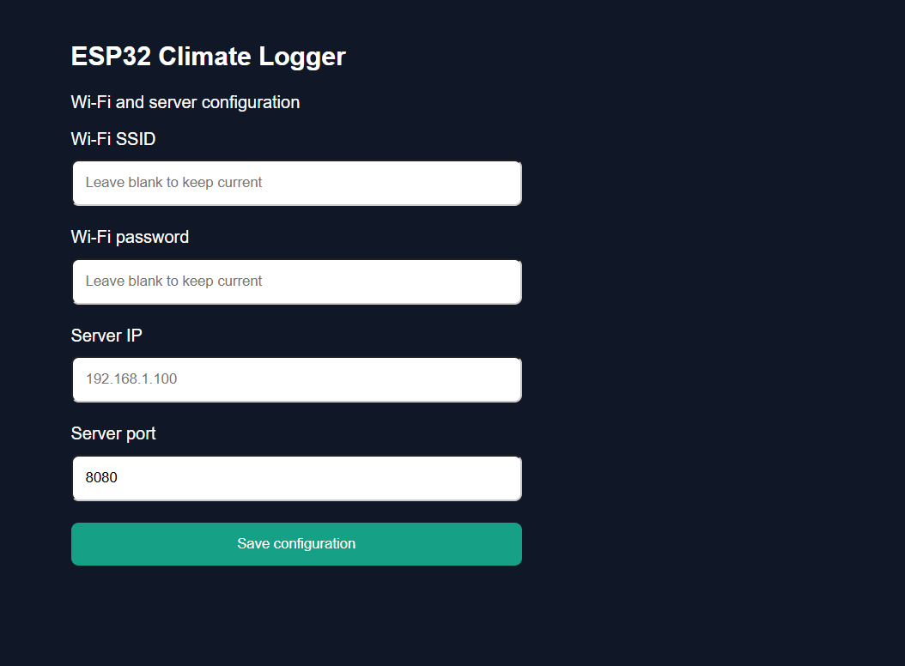
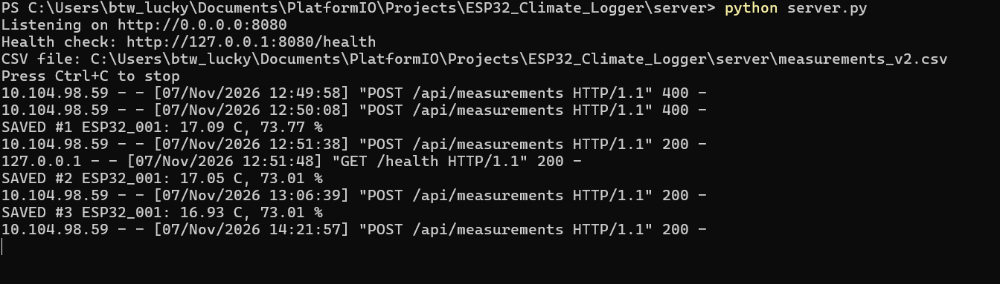
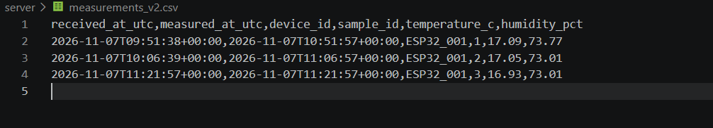

# ESP32 Climate Logger

An ESP32-based environmental monitoring system that measures temperature and relative humidity using an AHT10 sensor and periodically uploads data to a Python HTTP server.

## Features

- Temperature and humidity measurement via I²C
- Wi-Fi connectivity
- HTTP POST data transmission every 15 minutes
- Persistent offline measurement queue
- Automatic retry when the server becomes available
- Server IP and port configuration through a web interface
- Configuration mode activated by holding a push button for 3 seconds
- CSV data logging on the Python server

## Getting Started

New to this project? Follow the [Quick Start Guide](QUICK_START.md) to configure the ESP32, connect to Wi-Fi, start the Python server, and verify your first sensor measurements.

## Hardware

| Component      | Description                     |
| -------------- | ------------------------------- |
| ESP32-WROOM-32 | Main microcontroller            |
| AHT10          | Temperature and humidity sensor |
| Push button    | Configuration mode activation   |
| USB cable      | Power supply                    |

## Pin Configuration

| ESP32  | Connection  |
| ------ | ----------- |
| GPIO21 | AHT10 SDA   |
| GPIO22 | AHT10 SCL   |
| 3V3    | AHT10 VIN   |
| GND    | AHT10 GND   |
| GPIO27 | Push button |
| GND    | Push button |

## Hardware Prototype

## Wi-Fi Configuration

Hold the configuration button for 3 seconds to start the ESP32 access point.

Connect to `ESP32-Climate-Setup` and open `http://192.168.4.1` to configure the Wi-Fi network and server address.

## Data Transmission

The ESP32 sends temperature and humidity measurements to:

`POST /api/measurements`

The Python server receives the data and stores the measurements in CSV format.

## Python Server

Run the server using:

`python server/server.py`

## Recorded Measurements

Example measurement data is available in `data/sample_measurements.csv`.

## Development Tools

- Visual Studio Code
- PlatformIO
- Arduino Framework
- C++
- Python

## Project Status

The hardware prototype, Wi-Fi configuration, HTTP transmission and CSV logging have been tested successfully. Extended offline queue recovery testing is ongoing.

## License

This project is licensed under the MIT License.
See the [LICENSE](LICENSE) file for details.

Copyright (c) 2026 wodi0152.
